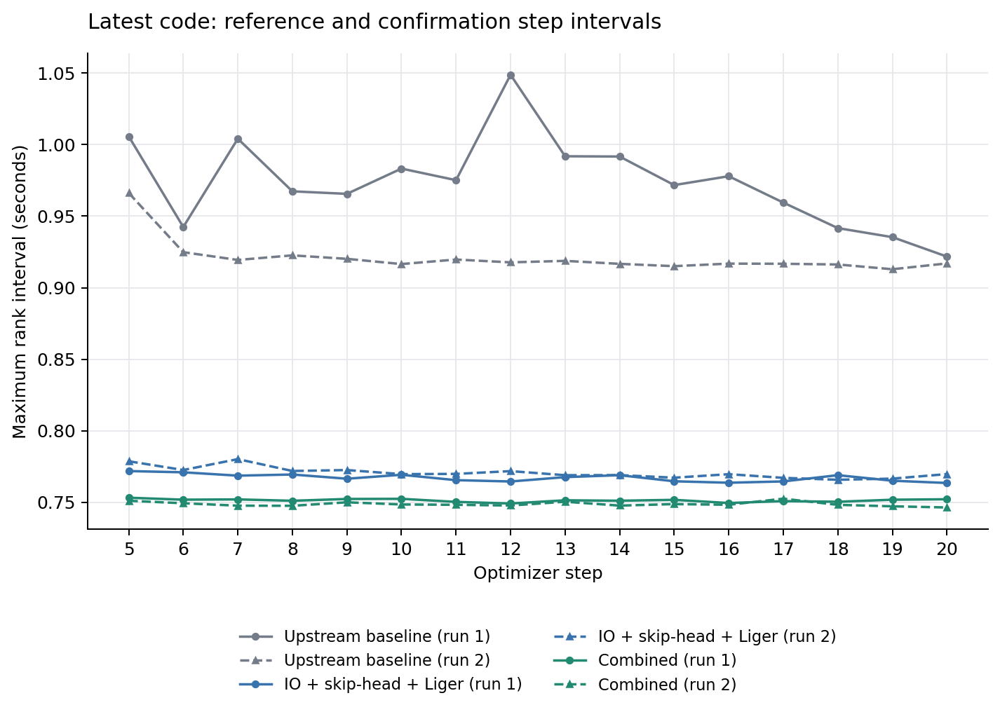

# H20 八卡 Stage2 复现与优化（2026-10-20）

最终实测组合为 **Liger + IO/skip-head + DDP256 + prefix/boundary复用 + theta/accel factor cache**。两次独立重启的稳态均值为 **0.750061 s/step、10.666 samples/s**；相对两轮最新上游baseline，约 **1.26×吞吐、耗时下降20.84%**。在已有 Liger + IO/skip-head 完整栈上，本轮三候选组合的额外耗时下降为 **2.454%**、吞吐提升 **1.0252×**；factor 单项没有实测加速证据。

上游baseline两轮均值为 **0.973967 / 0.921064 s/step**，后一次低5.43%，差异原因未经独立验证。采用两轮汇总而非较慢首轮作headline，不能沿用单轮约1.30×的倍率；观察到的run范围也不是置信区间。稳态收益与短任务总耗时须分开看，下文列出完整manifest成本。

## 环境与测量口径

H20-GPU-04，单机 **8×H20、DDP、BF16、microbatch=1、accumulation=1、全局8 samples/step**。Stage2 冻结 VLM，训练参数2,280,592,386；关闭 checkpointing、DeepSpeed、保存和评估。同一 checkpoint、20个真实导航样本，两个实验臂均按相同索引重复8倍形成160条输入。不跨step复用KV或模型激活；标准的每次forward内KV仍供expert使用。

实际环境：Python 3.12.3、PyTorch 2.8.0+cu128、Transformers 4.57.1、Accelerate 1.13.0、FlashAttention 2.8.3、Liger 0.7.0、PhysicalAI-AV 0.2.2、NCCL 2.27.3、CUDA runtime 12.8.90；Nsight Systems 2025.3.2。旧基线 HEAD 为 `9cd8718`，最新基线 HEAD 为 `2e907da`，各运行的实际差异见 tracked patch 与源码快照。

最新baseline固定在upstream `2e907da`，注入相同测量callback和默认关闭的新helper，显式关闭Stage2新增开关，保留上游默认zip/collate cache及worker配置；实际patch已保存。

最终clean checkout的验证core为 `2906343`，模型/优化运行源码与r3实测版本一致；运行时来源仍以各自manifest、patch和SHA为准。

每个 rank 在 optimizer-step end 做 CUDA synchronize，记录相邻 step-end 的 wall interval，包含数据准备及期间日志开销。稳态取 **steps 5–20（含端点，共16项）**：每步先取 rank 最大值，再求 mean/median/p90；samples/s=8/mean。重复结果合并两个run的32个interval，因每run项数相同，pooled mean也等于两个run mean的平均。每组仅 **2次独立重启**，32个interval不是32次独立实验，不作统计显著性声明。

每次新建结果目录并核验退出码、run ID、world size及完整步数，拒绝旧 JSON。profile 单独运行，不参与吞吐倍率。

## 稳态结果与三项候选

| 最新代码配置 | 独立重启数 | mean s/step | median | p90 | samples/s |
|---|---:|---:|---:|---:|---:|
| 最新上游 baseline | 2 | 0.947515 | 0.930062 | 0.991816 | 8.443 |
| Liger + IO/skip-head 对照 | 2 | 0.768929 | 0.768988 | 0.772506 | 10.404 |
| 最终完整组合 | 2 | **0.750061** | **0.750373** | **0.752344** | **10.666** |

Liger 对照的两个run mean为 **0.767135 / 0.770724**，组合为 **0.751361 / 0.748760**。两次组合均快于两次对照，但样本量仍只有两次重启；不把该结论扩展为所有批量、数据量或训练时长均更快。



同色表示同一配置，实线/虚线为两次重启；[两轮汇总JSON](results/20261020/confirmation_summary.json)保留实际run mean及汇总方法。

三项候选均在 **`latest_liger_r1` 的 Liger + IO/skip-head 完整栈**上独立追加，以其0.7671345853 s/step为固定对照；不是相对 IO/skip-head alone，也不事后换用较慢的r2放大倍率：

| 候选 | 实测 mean s/step | 相对固定对照耗时变化 | 依据与结论 |
|---|---:|---:|---|
| DDP bucket 128/256 MiB | 128：0.762082；256：0.758738 | −0.66% / **−1.09%** | HF实际传入bucket_cap_mb；组合选择256。单项各一次，不保证更大bucket总是更快或浮点bitwise不变。 |
| prefix + Python int boundary复用 | 0.764525 | −0.34% | 冻结VLM、B1、无padding、默认RoPE等guard下裁掉future_start后的无用suffix，并复用边界。rank0为20/20次激活、累计裁2620 tokens、零fallback。 |
| 固定theta/accel Cholesky factor cache | 0.767794 | **+0.086%** | `latest_factor_r2` 中action_space两role各miss1/hit19、零fallback/eviction，确认复用；没有单项提速证据，不单独推荐为性能收益。 |

对照run mean自身相差约0.47%，prefix等小差值须保守解释。最终组合保留全部三候选用于交互对照；不能将2.454%的组合收益分摊给某一项。旧式不完整 KV cache 键缺乏安全等价证明，未迁移；compile关闭。

作为历史复现，以下为同一测量口径的单轮安全旧栈与最新IO组合：

| 配置 / run | mean s/step | median | p90 | samples/s |
|---|---:|---:|---:|---:|
| 旧基线 `legacy_baseline_r3` | 1.827596 | 1.096996 | 3.211243 | 4.377 |
| 旧IO/skip-head `legacy_io_skip_r3` | 0.879442 | 0.875706 | 0.937914 | 9.097 |
| 旧安全IO/skip + 旧Liger `legacy_liger_r1` | 0.774087 | 0.768774 | 0.789361 | 10.335 |
| 最新IO/skip-head `latest_io_skip_r4` | 0.819881 | 0.819418 | 0.822219 | 9.758 |

旧IO组合相对旧基线 **2.078×**，再加旧Liger为 **2.361×**；KV/compile均关闭。新旧代码、worker及Liger实例patch行为不同，跨版本差值只作完整配置比较。安装版Transformers在Torch≥2.8时已默认 `adamw_torch_fused`，显式指定仅固定配置，不计作新优化收益。

## 预加载与整进程成本

完整栈每rank缓存20个CPU样本，tensor payload **1,415,666,560 bytes/rank**（八rank约11.33 GB）；预算4 GiB/rank，超限报错，读取返回独立副本。rank并行预处理，rank0准备时间不能简单乘8当作启动耗时。

下表总时间统一为成功 `manifest.json` 的 `ended_utc - started_utc`，包含配置探测/解析、torchrun、载入、预处理与20步训练，与稳态是两个指标：

| 配置 / run | manifest整进程秒 | rank0 preload秒 | 稳态mean s/step |
|---|---:|---:|---:|
| `legacy_baseline_r3` | 112.790 | 无 | 1.827596 |
| `legacy_io_skip_r3` | 136.622 | 旧实现无独立计时 | 0.879442 |
| `legacy_liger_r1` | 134.169 | 旧实现无独立计时 | 0.774087 |
| `latest_baseline_r3 / r4` | 99.053 / 97.985 | 无 | 0.973967 / 0.921064 |
| `latest_liger_r1 / r2` | 132.069 / 135.554 | 42.054 / 44.921 | 0.767135 / 0.770724 |
| `latest_combined_r1 / r2` | 133.027 / 134.676 | 44.099 / 44.289 | 0.751361 / 0.748760 |
| `latest_nopreload_r1` | **94.330** | 无 | 0.780564 |
| `latest_workers0_r1` | 132.140 | 44.045 | 0.812646 |

旧IO组合的 **2.078×仅为稳态**，20步整进程反而慢 **21.13%**；旧Liger安全栈虽有2.361×稳态倍率，整进程仍慢约18.96%。最终组合的20步总时间133.027/134.676秒，也高于最新baseline的99.053/97.985秒。最新Liger完整栈取消preload、保留drop-raw/8 workers时，稳态比r1慢1.75%，但总时间由132.069降至94.330秒，少 **28.58%**。对这次短任务取消preload更合算；更长训练的收支平衡需实测，不能从20步线性外推。

保留preload而仅把workers从8改为0，稳态反而慢 **5.93%**，故保留8 workers。nopreload与workers0是两个独立消融，不是两者组合；prefix/factor在这两个消融中关闭。

## 正确性与实现边界

recipe CPU **44项**与benchmark/Nsight解析 **16项**，共60项通过；clean checkout的既有回归为根pytest **32项**、Alpamayo1.5 Stage1 loader **8项**、Alpamayo1 Stage1 loader **8项**，另48项通过，合计 **108项CPU测试通过**。`compileall`另通过，不计作一个测试。`data_equivalence_r2` 对全部 **20/20个真实PAI unique样本**通过：源读取确定性，普通与cached collator的实际tensor shape/dtype/value、text/token ID精确相等，metadata按Sequence值相等，仅从未用kwargs去掉image_frames，以及破坏返回副本后再读的隔离。该检查显式禁用CUDA，只载配置，不载完整模型权重。

当前helper版本由 **`correctness_r3`** 验证，附tracked patch与实际源文件SHA；独立skip/prefix沿用代码未改的r2，prefix也被r3 combined再次覆盖。使用同权重、同collated sample和固定Python/NumPy/CPU/CUDA RNG，对照各报告内的baseline完整trainable gradient；VLM全部冻结且无梯度。

| 数值阶段 | loss | gradient relative L2 | gradient max absolute | 依据 |
|---|---:|---:|---:|---|
| baseline | 0.33454859256744385 | 参考 | 参考 | r3 |
| skip-head | 0.33454859256744385 | 0.00114867634 | 0.000244140625 | r2通过 |
| prefix + skip-head | 0.33454859256744385 | 0.00110833584 | 0.000244140625 | r2通过 |
| trajectory + skip-head | 0.33454859256744385 | 0.00119308998 | 0.000244140625 | r3通过 |
| Liger + skip-head | 0.33611708879470825 | 0.01894562199 | 0.0048828125 | r3通过 |
| 四开关combined | 0.33611708879470825 | 0.01895305024 | 0.0048828125 | r3通过 |

loss容差为 `0.001 + 0.02 × |baseline loss|`；全量梯度须同时满足relative L2≤0.05、max absolute≤0.05，并检查finite及相同梯度存在模式。实际bf16复测存在小幅浮点差异，结论为容差内通过，**不宣称bitwise梯度一致**，也不确定归因于某个算子。这些证据限定于记录的数据、模型及配置，不代表长期收敛等价。

当前recipe开关默认关闭，重复倍数默认1；基准显式设为8。preload只对训练集启用，适用于确定性小数据；不改eval或全局inference实现。factor仅缓存固定theta/accel系统，不缓存输入相关velocity系统；有容量限制、完整的shape/device/dtype/求解参数key及失效回退。输出归一化始终读取live affine buffers。

Liger 0.7.0的公开Qwen3-VL patch未实际处理已实例化MLP的SwiGLU；本轮在公开patch后绑定公共 `LigerSwiGLUMLP.forward`，验证VLM/expert **各145个RMSNorm、36个MLP**及RoPE/vision RoPE真实生效，保留参数对象与checkpoint key。skip-head只用于冻结VLM，省去不参与轨迹loss的CE/全序列logits；联合VLM训练保留原路径。

本轮使用 `from_pretrained`、`model.pretrained_model_name_or_path` 与实际checkpoint的config/state_dict布局；不能直接照搬旧 `model.checkpoint_path`，未对其他转换格式作全面兼容性证明。源 `config.json` SHA256为 `36b49c55cf5cac348de2359607e67e59a852c209e45ac91be4986fca30c278a7`，annotations为 `3c0f277f0d65cda15fcfa38b2654971182a5eefb854d85ab94a3ee7e538fac25`。

诊断记录保留而不计作成功证据：correctness_r1候选未激活；data_r1仅因ListConfig/list类型比较误报；factor_r1的affine `_version` key随DDP广播递增，造成两role各miss20/hit0、evict32。修补移除与固定LHS无关的输出affine key、保留live归一化读取，并经广播/真实affine变化CPU回归、r3数值和factor_r2八卡miss1/hit19验证。r2.sources为结束后补采且当时源码未变，原JSON保留。

## Nsight归因

独立采集steps 5–8，strict-window验证 **8 process、8 device、每步标签及kernel完整**。原IO/skip profile的language/visual前向GPU kernel duration sum约418.6/147.5 ms/step；前向hook未覆盖expert backward，跨stream kernel sum不能当critical path，`nvjet_*`保留other而不猜为GEMM。

原IO/skip与最终组合两份profile均通过strict校验，各 **8 process / 8 GPU、32个完整process-step（steps 5–8）**。IO记录0条边界裁切kernel，最终组合记录2条FusedAdamW kernel，跨出所选窗口共0.226098 ms，已按窗口裁切；这2条均非NCCL或crop kernel。

| profile观测量 | IO/skip | 最终组合 |
|---|---:|---:|
| StreamSynchronize / process-step | 576 | 427 |
| scalar crop区间StreamSynchronize / process-step | 144 | **0** |
| NCCL kernels / device-step | 113.5 | 20.5 |
| NCCL GPU kernel duration sum，ms/device-step | 118.313 | 70.591 |
| language前向GPU kernel sum，ms/device-step | 418.565 | 366.646 |
| visual前向GPU kernel sum，ms/device-step | 147.501 | 133.967 |
| expert前向GPU kernel sum，ms/device-step | 19.844 | 16.762 |
| StreamSynchronize host API sum，ms/process-step | 259.164 | **344.508** |

32/32个样本的crop同步均从144降至0（总4608→0）；总StreamSynchronize从18432降至13664，NCCL kernel数从3632降至656。末态rank0验证prefix 10/10激活、累计裁1310 tokens，theta/accel各miss1/hit9、零fallback/eviction。该profile对照同时改变 **Liger、DDP256、prefix、factor**，只支持组合现象，不能作为单项因果归因。host同步等待总时间反而增加，trajectory区间host API sum由0.159升至303.091 ms/process-step，显示等待位置转移；GPU kernel sum可跨stream重叠，也不等于step耗时。三项新候选的纯增量以非profile的Liger重复组→组合重复组 **2.454%耗时下降**为依据。

原profile单process有576次StreamSynchronize/step，但visual的311次仅约5.44 ms host API sum。外层另147次包括1次VLM后nonzero、144次scalar crop及2次后续同步；约197.8 ms nonzero等待包含已排队VLM GPU工作，不能当作可直接省掉197.8 ms。SQL、窗口及详细归因见[profile证据](results/20261020/profile_findings.md)。

## 复现与产物

在仓库根目录、相同依赖与源码环境中设置本地 `CHECKPOINT`、`DATA`、`ANNOTATIONS`、`CHUNK_IDS`。最终组合命令如下；每次采用新的run ID：

```bash
PYTHONPATH=recipes:src python -m alpamayo1_5_sft.benchmark_h20.run \
  --python "$(command -v python)" --work-dir "$PWD" \
  --config-path pkg://alpamayo1_5_sft/configs --config-name sft_stage2_nav \
  --result-dir /work/results --run-id combined-b1-r1 --nproc-per-node 8 \
  --global-samples-per-step 8 \
  --env APPLY_REPEAT_DATA=8 --env APPLY_PRELOAD=1 --env APPLY_DROP_RAW=1 \
  --env APPLY_VLM_SKIP_HEAD=1 --env APPLY_LIGER_KERNEL=1 \
  --env APPLY_LIGER_SWIGLU=1 --env APPLY_VLM_PREFIX_ONLY=1 \
  --env APPLY_TRAJECTORY_FACTOR_CACHE=1 \
  --env APPLY_COMPILE_EXPERT=0 --env APPLY_VLM_KV_CACHE=0 \
  --env APPLY_SAMPLE_CACHE=0 --env APPLY_NVTX=0 \
  --env OMP_NUM_THREADS=4 --env TOKENIZERS_PARALLELISM=false \
  --override "model.pretrained_model_name_or_path=$CHECKPOINT" \
  --override model.stage1_vlm_checkpoint_path=null \
  --override model.cotrain_vlm=false \
  --override "data.train_dataset.local_dir=$DATA" \
  --override "data.train_dataset.annotations_path=$ANNOTATIONS" \
  --override "data.train_dataset.chunk_ids=$CHUNK_IDS" \
  --override "data.val_dataset.local_dir=$DATA" \
  --override "data.val_dataset.annotations_path=$ANNOTATIONS" \
  --override 'data.val_dataset.chunk_ids=[2868]' \
  --override trainer.per_device_train_batch_size=1 \
  --override trainer.gradient_accumulation_steps=1 \
  --override trainer.dataloader_num_workers=8 \
  --override trainer.dataloader_persistent_workers=true \
  --override trainer.dataloader_prefetch_factor=4 \
  --override trainer.ddp_find_unused_parameters=false \
  --override ++trainer.ddp_bucket_cap_mb=256 \
  --override ++trainer.optim=adamw_torch_fused \
  --override performance.zip_cache=true --override performance.collate_cache=true \
  --override performance.tf32=true --override performance.cudnn_benchmark=true \
  --override ++trainer.save_strategy=no --override ++trainer.eval_strategy=no
```

默认20步、logging_steps=1。Liger完整栈对照关闭prefix/factor并取消bucket override；IO/skip对照再关闭Liger。最新上游baseline保持原yaml已有的zip/collate cache、TF32及8 workers，关闭APPLY的preload/drop-raw/skip-head/Liger/prefix/factor，恢复ddp_find_unused_parameters=true；repeat仍为8。不能只改run名称。短任务nopreload另关preload；worker0消融则保留preload并设置workers=0、persistent=false、prefetch=null。

profile使用新的run ID、`--mode profile --max-steps 10 --steady-end-step 10`和NVTX=1，capture steps 5–8；建议 `--nsys-option=--sample=none --nsys-option=--cpuctxsw=none --nsys-option=--wait=all --nsys-option=--flush-on-cudaprofilerstop=false`。profile结果不计算吞吐倍率。

[归档索引](results/20261020/README.md)、[全部run汇总](results/20261020/runs.csv)及[机器可读汇总](results/20261020/runs.json)保留每run manifest、resolved config、原始steps/rank数据、summary、runtime/data/final统计及来源哈希。公开归档保存patch/harness snapshot的哈希；完整正文、训练日志及原始Nsight文件另保留在实验机器的results目录和本地未纳入Git的artifacts目录。正确性、108项CPU测试/编译日志与数据等价报告随公开归档保存，失败诊断也保留。
